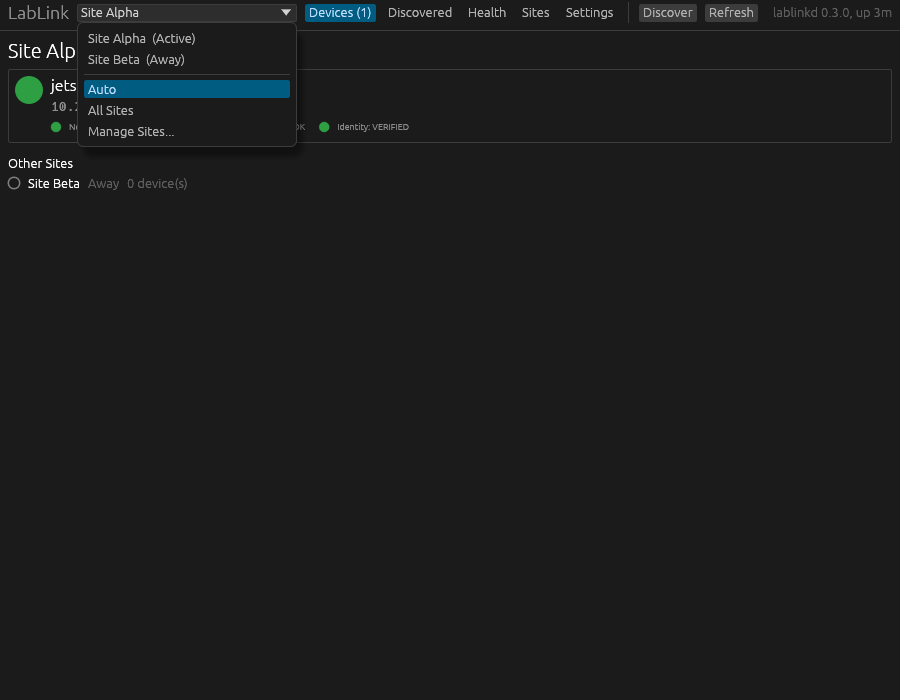
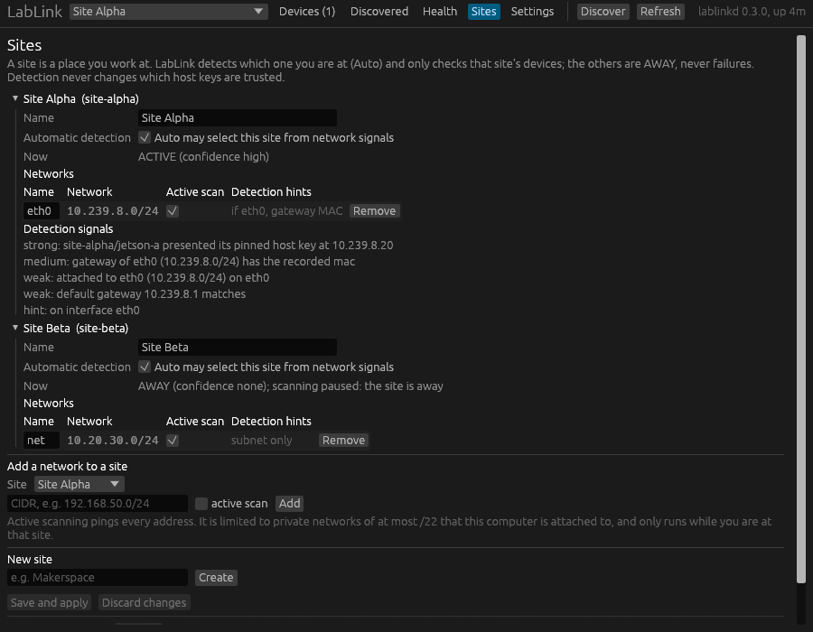

# LabLink

LabLink is a lightweight local device discovery, identity, SSH and health
manager for robotics labs, edge devices, workshops and Linux workstations.
You give each machine a name once; LabLink finds it on the networks you
allow, proves it is the machine you trusted (by its SSH host key, never by
its IP address), tells you whether it is healthy, and connects you to it by
name even after DHCP hands it a new address.

It is a small per-user daemon (`lablinkd`), a CLI (`lablink`) and a desktop
app (`lablink-gui`), written in Rust for Linux. The daemon runs as you (a
systemd user service, no root), uses a few megabytes of memory and a fraction
of a percent of one CPU core ([docs/PERFORMANCE.md](docs/PERFORMANCE.md)),
and answers the CLI and the app over a private Unix socket. There is no
network listener.

```console
$ lablink status
Site Alpha  ACTIVE  READY  (confidence: high)

DEVICE           STATE  IP          NETWORK  SSH  IDENTITY  LATENCY  LAST SEEN
gpu-workstation  GREEN  10.42.0.15  ONLINE   OK   VERIFIED  <1 ms    <1s
jetson-a         GREEN  10.42.0.31  ONLINE   OK   VERIFIED  <1 ms    <1s

Other sites
  Site Beta            AWAY  2 (not checked)

$ lablink ssh jetson-a
lablink: jetson-a -> ops@10.42.0.31:22 (host key pinned by LabLink)
```

## Core workflow

```text
Install -> lablink init -> select/create a Site -> Discover -> Adopt
        -> verify/trust the host key -> copy your SSH key -> Connect
```

```bash
lablink init                         # name this site, choose its networks, start the service
lablink discover                     # find hosts on the networks you allowed
lablink adopt 10.42.0.31 jetson-a --profile jetson --user ops
lablink trust jetson-a               # compare the fingerprint with the device, then pin it
lablink copy-id jetson-a             # install your SSH key (you type the password once, to ssh-copy-id)
lablink ssh jetson-a                 # connect by name; the IP may change
lablink doctor                       # read-only health checks of this site's devices
```

`lablink trust` shows the device's host-key fingerprints and pins them only
after you confirm. Compare them with the device itself first, for example on
its console: `ssh-keygen -lf /etc/ssh/ssh_host_ed25519_key.pub`.

The desktop app walks through the same steps: a first-run wizard (site name,
networks, service), a **Discovered** list with **Inspect / Adopt**, a
two-step **Trust host key** panel, **SSH Setup**, **Open SSH terminal**,
a **Health** dashboard and a **Sites** tab. The **Files** workspace adds
dual-pane SFTP browsing, file and folder transfers, a transfer queue and
cancellation/retry for trusted devices. Appearance settings include True Black,
Light and System Default. See [Files workspace](docs/FILES.md) for supported
operations and security limits.

## Common commands

```bash
lablink status [device]              # health of the current site, or one device (exit code = color)
lablink doctor [device...]           # read-only checks: SSH, disk, GPU, temperature, ROS 2, DDS, reachability
lablink devices                      # full identity and health detail
lablink discover                     # run discovery now
lablink ssh <device>                 # interactive SSH with the pinned identity
lablink exec <device> '<command>'    # one remote command; the remote exit code is preserved
lablink sites                        # every site: ACTIVE / AWAY / UNKNOWN
lablink site                         # the current site and the evidence for it
lablink site use <site|auto>         # choose a site by hand, or back to automatic detection
```

Every command that returns data supports `--json`; exit codes are fixed
(see [Exit codes](#exit-codes)). `lablink --help` lists everything else
(`inspect`, `history`, `resolve`, `set`, `export`, `import`,
`support-bundle`, `metrics`, ...). Bash completion is installed by the
package and by `lablink init`.

## Security model

- **An IP address is a location, not an identity.** LabLink records
  addresses, MACs and hostnames, but only the SSH host key proves which
  machine answers. When a device moves, LabLink verifies the host key before
  using the new address, and the host must prove it holds the private key
  (a credential-free OpenSSH handshake): a copied public key is not enough.
- **SSH host keys establish the server's identity.** Pinned keys are written
  to a LabLink-owned `known_hosts` file and every `ssh`, `exec`, `copy-id`,
  login check and health check runs with `StrictHostKeyChecking=yes` against
  it.
- **Public-key authentication establishes your access.** LabLink uses your
  OpenSSH client, keys, ssh-agent and `~/.ssh/config`. It stores no
  passwords and no private keys. `lablink copy-id` runs `ssh-copy-id`
  through the pinned identity, so the password you type there can only
  reach the verified machine.
- **Trust is explicit.** Discovering a host never trusts it; adopting it
  never pins its key. A key is pinned only by `lablink trust` (or the GUI's
  **Pin** button) after you saw the fingerprint, by a fingerprint you wrote
  in the config, or by a matching entry already in your own
  `~/.ssh/known_hosts` for that device's name. `lablink ssh`/`exec` refuse a
  device without a pin unless you pass `--unpinned`, and `lablink resolve`
  prints only verified addresses.
- **A changed host key stops access.** A mismatch is a RED security stop:
  `ssh`, `exec`, `copy-id` and checks refuse (exit 6) until you verify the
  new key on the device and replace the pin yourself
  (`lablink trust <device> --replace`). There is no bypass.
- **Scans need explicit permission.** LabLink actively scans only networks
  you allowed with `active_scan`, that are private (RFC 1918 or link-local),
  at most a /22 by default (never more than a /20), directly attached to this
  computer, and belong to the site you are at. Everything else is passive
  (the kernel neighbor table, mDNS, name resolution).
- **Sites organize environments; they never weaken identity verification.**
  Which site is active decides only which devices are probed and reported.
  It never pins, unpins or accepts a host key.
- **Local only.** The daemon listens on a Unix socket in a 0700 directory,
  checks that every client runs as the same user, and refuses everyone else.
  Clients in turn refuse a socket served by another user.

Details: [SECURITY.md](SECURITY.md), [docs/SSH_IDENTITY.md](docs/SSH_IDENTITY.md),
[docs/THREAT_MODEL.md](docs/THREAT_MODEL.md) and
[docs/RELEASING.md](docs/RELEASING.md).

## Multi-site use

A **site** is a place you work at: a robotics lab, an office, a workshop, a
club, a test facility, a home network. Each site has its own networks and
devices:

```text
Site Alpha
├── lab network        10.42.0.0/24
├── robot network      192.168.50.0/24
├── jetson-a
├── robot-a            (reached through jetson-a)
└── gpu-workstation

Site Beta
├── club network       10.20.30.0/24
├── jetson
└── robot-b
```

- **Auto (the default).** LabLink infers where you are from non-secret
  signals: the subnets this computer is attached to, interface names, the
  default gateway's address and MAC address, the Wi-Fi network name (a hint
  only), devices of a site seen on the local link, and, strongest of all,
  devices that present their pinned SSH host key on the site's own networks.
  A subnet alone is weak evidence (many places use `192.168.1.0/24`); a
  recorded gateway MAC that differs voids it. `lablink site` shows the
  evidence and a confidence of high, medium or low.
- **AWAY sites are not failures.** Devices of a site you are not at are not
  probed and are reported GRAY with `site_state: away`, never RED. Your
  laptop leaving the lab is not an outage.
- **UNKNOWN** means two sites match equally well (for example the same
  subnet and nothing else). Their devices are checked, an unreachable one is
  not reported RED, nothing is scanned, and bare names stay ambiguous until a
  host key, a gateway MAC or your choice settles it.
- **Manual override.** `lablink site use site-beta` (or the site selector in
  the app) makes a site active by hand; `lablink site use auto` returns to
  detection. The choice survives restarts.
- **All Sites.** `lablink status --all` and the app's **All Sites** view list
  every site; AWAY ones are shown as such and never counted as failures.
- **Names can repeat across sites.** Every device has a canonical reference
  `site/name` (`site-alpha/jetson`). A bare name works when it is unique, or
  when exactly one of the matching devices belongs to a site LabLink is
  confident you are at. Otherwise LabLink refuses to guess (exit 8):

  ```text
  Ambiguous device 'jetson':

  Site Alpha / jetson
  Site Beta / jetson

  Use:
    lablink ssh site-alpha/jetson
    lablink ssh site-beta/jetson
  ```

- **Adding a site.** At the new place run `lablink site add "Site Beta" --scan
  10.20.30.0/24` (or use **Sites -> New site** in the app). Attached networks
  record their interface, gateway, gateway MAC and Wi-Fi name so the site is
  recognized on the next visit.

A configuration written before sites existed (top-level `networks:` and
`devices:`) keeps working: it is read as one site called `default`, and the
cache is migrated on first start. LabLink writes the `sites:` layout the next
time it saves the file.

## Install

Supported: **Ubuntu 20.04, 22.04 and 24.04 LTS** (x86_64). No Rust toolchain
is needed. Download the release files and check them against `SHA256SUMS`:

```bash
sha256sum -c SHA256SUMS --ignore-missing
```

**Debian package** (installs `lablink`, `lablinkd`, `lablink-gui`, a systemd
user unit, bash completion, a menu entry and an icon; pulls in the OpenSSH
client; nothing starts until you run setup):

```bash
sudo apt install ./lablink_0.3.1_amd64.deb
```

**Tarball** (any x86_64 Linux with glibc 2.31 or newer, installs into
`~/.local`, no root):

```bash
tar xzf lablink-0.3.1-x86_64-linux.tar.gz
cd lablink-0.3.1-x86_64-linux && ./install.sh
```

Then run `lablink init` or open **LabLink** from the applications menu.
Removing the package (or `./uninstall.sh`) keeps your configuration and
pinned keys; see [docs/INSTALL.md](docs/INSTALL.md) for removal, purging and
building from source.

## The desktop app


- **Site selector** (top bar): every site with its state, **Auto**, **All
  Sites** and **Manage Sites...**. Choosing a site is a manual override;
  **Auto** returns to detection.
- **Devices:** the current site with its READY / DEGRADED / NOT READY state,
  a card per device, and **Other Sites** below (AWAY, not checked).
- **Discovered:** untracked hosts with MAC, SSH port and host-key
  fingerprints; **Inspect / Adopt...** names a host and chooses its site,
  label, SSH user and type. Adopting never trusts the key.
- **Device page:** where the device is in Adopt -> Trust -> SSH login ->
  Managed, the explanation of any problem with buttons that fix it, and
  every identity and health detail.
- **Health:** the read-only doctor checks of the current site.
- **Sites:** create and rename sites, choose their networks and active
  scanning, turn automatic detection on or off per site, and see the
  detection signals.
- **Settings:** monitoring interval, history retention, terminal, per-device
  runtime settings and the background service.

| Site selector | Sites |
|---|---|
|  |  |

## Configuration

`~/.config/lablink/config.yaml` is optional to edit by hand: `lablink init`,
`lablink site add` and the app write it, validate it first and keep the
previous version as a backup. Unknown keys are rejected. A two-site example
with every option is in [config/example.yaml](config/example.yaml); check a
file with `lablink check-config`.

## Exit codes

| Code | Meaning |
|---|---|
| 0 | OK (`status <device>`: GREEN) |
| 1 | internal failure |
| 2 | invalid usage or configuration |
| 3 | daemon not running |
| 4 | unknown device or site |
| 5 | device unreachable (no usable address, offline, or its site is AWAY) |
| 6 | host-key mismatch: security stop |
| 7 | refused by policy (for example a scan outside the allowlist, or `trust` without confirmation) |
| 8 | ambiguous device name: use `site/name` |
| 10 / 11 / 12 | `status <device>` / `doctor`: YELLOW / RED / GRAY (GRAY includes AWAY) |
| 124 | `exec --timeout` expired |
| 255 | the OpenSSH client failed (`exec`) |

Scripts and AI agents: [docs/AUTOMATION.md](docs/AUTOMATION.md).

## Documentation

- [docs/INSTALL.md](docs/INSTALL.md): install, upgrade, remove, build
- [docs/ARCHITECTURE.md](docs/ARCHITECTURE.md): components, discovery, identity, sites, persistence
- [docs/STATUS_MODEL.md](docs/STATUS_MODEL.md): GREEN / YELLOW / RED / GRAY and AWAY
- [docs/THREAT_MODEL.md](docs/THREAT_MODEL.md): what LabLink defends against, and how
- [docs/PORTABILITY.md](docs/PORTABILITY.md): what is Linux-specific, and the boundary for other OSes
- [docs/AUTOMATION.md](docs/AUTOMATION.md): JSON output and exit codes for scripts and agents
- [docs/TESTING.md](docs/TESTING.md), [docs/PERFORMANCE.md](docs/PERFORMANCE.md)
- [SECURITY.md](SECURITY.md), [CONTRIBUTING.md](CONTRIBUTING.md), [CHANGELOG.md](CHANGELOG.md)

## Development

```bash
cargo test --workspace                          # unit, integration and end-to-end tests
cargo clippy --workspace --all-targets -- -D warnings
cargo fmt --all --check
cargo deny check && cargo audit                 # licenses, sources, advisories
scripts/release.sh                              # release artifacts of HEAD, built in Ubuntu 20.04
BASE=ubuntu:20.04 scripts/cleanroom.sh          # fresh-user install test in containers
```

The toolchain is pinned in `rust-toolchain.toml`. Tests run complete daemons
in-process on a simulated network and never touch your real network,
configuration or systemd user manager. See [CONTRIBUTING.md](CONTRIBUTING.md).

## License

Apache License 2.0: see [LICENSE](LICENSE) and [NOTICE](NOTICE). Third-party
components compiled into the binaries, and their licenses, are listed in
[THIRD_PARTY_LICENSES.md](THIRD_PARTY_LICENSES.md).
