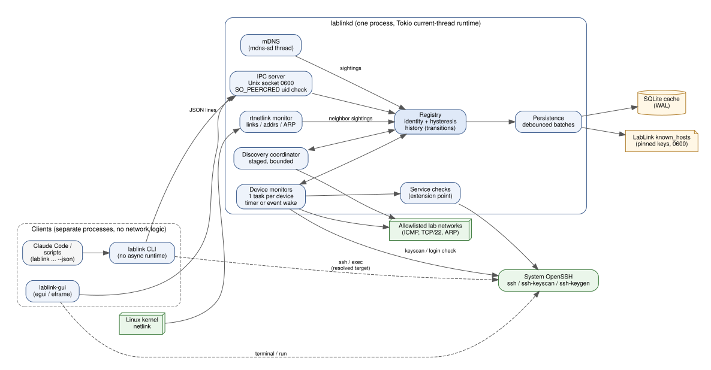
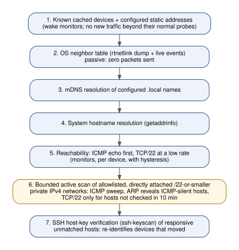

# LabLink architecture

LabLink finds lab machines and robots on the network, tracks who they are
independently of their IP address, watches their SSH health, knows which of
your sites you are at, and lets people and agents reach devices by name. This
document describes what is implemented in this repository, not aspirations;
open items are listed at the end.



## Design constraints

| Constraint | How it is met |
|---|---|
| Very low idle CPU and memory | One daemon process on a Tokio current-thread runtime; timers and kernel events instead of polling; ICMP for liveness; debounced disk writes. Measured in [PERFORMANCE.md](PERFORMANCE.md). |
| Never identify a device by IP alone | Identity is a set of signals (host-key fingerprint, MAC, hostnames, static IPs, address history); see [Identity](#identity). |
| Never silently accept a changed host key | Mismatch is a RED security state; nothing is re-pinned without an explicit `lablink trust --replace`. |
| Never scan networks outside the allowlist | Active scans only run on configured `active_scan: true` networks that are private, at most a /22, directly attached, and belong to the active site; see [THREAT_MODEL.md](THREAT_MODEL.md). |
| A device at a place you are not at is not a failure | Sites: devices of AWAY sites are not probed and are reported GRAY; see [Sites](#sites). |
| Use the system OpenSSH, store no passwords | `ssh`, `ssh-keyscan` and `ssh-keygen` are invoked as subprocesses; non-interactive calls use `BatchMode=yes`. |
| CLI usable by agents | Deterministic tables, `--json` everywhere, a fixed exit-code contract ([AUTOMATION.md](AUTOMATION.md)). |

## Crates

| Crate | Kind | Responsibility | Notable dependencies |
|---|---|---|---|
| `lablink-core` | lib | Config parsing and validation (sites, migration of the single-site layout), CIDR allowlist and scan limits, health state machines, identity classification, site detection (`site`), status/color model, IPC protocol, blocking IPC client, exit codes. Pure and synchronous. | serde, serde_yaml_ng, ipnet |
| `lablink-platform` | lib | Platform-specific, read-only site signals: default gateways (`/proc/net/route`), ARP lookups, Wi-Fi SSID (`SIOCGIWESSID`). See [PORTABILITY.md](PORTABILITY.md). | libc |
| `lablink-ssh` | lib | Builds OpenSSH argument vectors, runs `ssh`/`ssh-keyscan`/`ssh-keygen` with timeouts and process-group kill, parses keys, computes `SHA256:` fingerprints, writes the pinned known_hosts file, classifies ssh failures. Synchronous. | sha2, base64, libc |
| `lablink-discovery` | lib | rtnetlink dump and event monitor (links, addresses, neighbor table), unprivileged ICMP echo, TCP connect probe, bounded-concurrency sweep runner, mDNS browse and `.local` resolution. | tokio, socket2, mdns-sd |
| `lablink-daemon` | lib + `lablinkd` | Registry, per-device monitors, discovery coordinator, persistence, IPC server, metrics, service-check extension point, test harness (`testing`). | rusqlite (bundled SQLite), tokio, tracing |
| `lablink-doctor` | lib | Read-only health checks: plans checks per device (config `checks:`, else the device profile), runs one batch SSH session per device through the same resolve and pinned-identity path as `exec`, renders human and JSON reports. | lablink-ssh |
| `lablink-setup` | lib | Actions shared by the CLI and GUI that are not daemon requests: first-run `init`, site creation, systemd user-service control, completion install, local network detection (`getifaddrs`, read-only), validated atomic config writes with backups, export/import, redacted support bundles. No probing. | libc, tempfile |
| `lablink-fieldnet` | lib | Optional Field Network: read-only host facts (NetworkManager, adapters, routes, sessions), preflight, the NetworkManager hotspot backend, client listing from the neighbor table and leases, macOS capability detection and guidance, and `ops` (the preflight plan and client classification the CLI and app share). Every OS call goes through a `System` trait, so tests use a scripted fake. | lablink-core, ipnet |
| `lablink-ros` | lib | Optional robotics mode: read-only ROS 2 / DDS inspection over the doctor's pinned SSH path (`Remote` trait), DDS XML scanning, the twelve checks and levels (`diagnose`), the opt-in active probe, `check` (the flow the CLI and app share), and `graph` (an interface for a future graph view). | lablink-doctor |
| `lablink-cli` | `lablink` | Client commands, prompts, human and JSON output, `ssh`/`exec`/`copy-id` via OpenSSH. No async runtime. | clap |
| `lablink-gui` | `lablink-gui` | Native egui client of the daemon API and `lablink-setup`: setup wizard, site selector and views, device lifecycle, Health, Sites and Settings tabs, and the optional Field Network and Robotics tabs (through `lablink-fieldnet` and `lablink-ros`, the same code the CLI runs). | eframe |

Dependency rule: clients depend on `lablink-core` (and `lablink-ssh` to launch
OpenSSH); only `lablink-daemon` depends on `lablink-discovery`. The GUI cannot
probe the network because it does not link the code that does. The optional
`lablink-fieldnet` and `lablink-ros` crates, used by the CLI and the GUI, send
no probes either: they read local state, call NetworkManager, or run fixed
scripts over pinned SSH. Neither is a dependency of the daemon, and neither
adds a daemon request.

### Why these choices

- **Tokio current-thread runtime.** The daemon is I/O bound with a handful of
  concurrent activities. One scheduler thread plus an on-demand blocking pool
  (SQLite writes, OpenSSH subprocesses, getaddrinfo; idle threads exit after
  10 s) keeps the steady-state thread count at 3 (main, mdns-sd, and at most a
  short-lived blocking worker).
- **Hand-written rtnetlink parser** (a few hundred lines with byte-level tests) instead
  of the `rtnetlink`/`netlink-packet-route` crates: the three message types used
  (`ifinfomsg`, `ifaddrmsg`, `ndmsg`) are stable kernel ABI, and the crates'
  APIs change frequently. No `ip` subprocesses are spawned.
- **mdns-sd** for passive mDNS: pure Rust, no Avahi D-Bus dependency, one
  internal thread. It can be disabled (`daemon.mdns: false`).
- **SQLite (bundled)** for the cache: transactional batches, crash safety via
  WAL, ad-hoc history queries, no system library needed. Records are JSON
  documents so the schema can evolve without migrations.
- **OpenSSH subprocesses** instead of an SSH library: no protocol code to trust,
  and the user's `~/.ssh/config`, agent, ControlMaster sockets and known_hosts
  keep working. Cost: a fork/exec per host-key scan or login check, which is why
  those run on transitions and at slow intervals only.

## Process boundaries

- `lablinkd` runs as the user (systemd **user** service), owns all network
  state, and is the only component that probes the network.
- `lablink` is short-lived. Every command except `ssh`, `exec` and
  `check-config`/`install-service` is a single request to the daemon. `ssh`
  and `exec` ask the daemon to resolve the device, then run OpenSSH directly
  (`ssh` replaces the CLI process with `exec(2)`, so the terminal and exit code
  belong to ssh).
- `lablink-gui` is a separate process that talks to the same socket.

## Daemon task model

All long-lived tasks are spawned on one `TaskTracker` and observe one
`CancellationToken`:

| Task | Count | Wakes on |
|---|---|---|
| IPC accept loop | 1 | connection |
| IPC connection handler | 0..32 (capped) | request, 30 s idle timeout |
| Device monitor | 1 per tracked device (idle while its site is AWAY or monitoring is off) | its timer, or a wake event |
| Discovery coordinator | 1 | request, network change, startup, optional `scan_interval_s` |
| Persistence | 1 | a dirty notification, then a debounce timer |
| rtnetlink monitor | 1 | kernel multicast message |
| Network-change debouncer | 1 | link/address event (2 s debounce) |
| mDNS consumer + browse tasks | 1 + one per service type | mDNS event |

Scan workers are bounded by `scan_concurrency` (default 32) and exist only
during a scan: exactly that many workers pull targets from a queue, so a /22
does not create 1022 tasks. A test (`no_runaway_task_creation`) asserts that
the task count returns to baseline after churn.

Shutdown (SIGTERM/SIGINT): cancel, wait up to 5 s for all tasks, record a
`daemon_stopped` event, flush everything to SQLite, remove the socket.

## Health monitoring

A device whose site is AWAY is not probed at all: its monitor waits until
the site becomes ACTIVE or UNKNOWN again. Otherwise each device monitor
sleeps for `check_interval_s` (default 5 s) while the device is reachable and backs off exponentially up to `offline_backoff_max_s`
(default 30 s) while it is not. Events can wake it early (an ARP failure for a
healthy device's address, an IP change, discovery, a settings change), but a
monitor never runs twice within 1 s, so an event storm cannot become a probe
storm, and an offline device's own ARP failures do not wake it.

One check round:

1. If the device has no usable address, resolve its configured hostnames
   (mDNS for `.local`, otherwise getaddrinfo), at most every `resolve_interval_s`.
2. **Liveness** of the current address: ICMP echo (unprivileged
   `SOCK_DGRAM`/`IPPROTO_ICMP`, no root). TCP/22 is probed every
   `port_check_interval_s` (default 30 s), or every round while the device is
   not ONLINE, or as a fallback when ICMP gets no answer. TCP connect + close
   shows up in the remote sshd log as a pre-auth disconnect, which is why it is
   not the 5-second probe. Hosts that never answer ICMP but do answer TCP are
   detected and switched to TCP liveness after 3 such rounds.
3. **Fail-over**: if the current address does not answer, the next known
   addresses (configured static IPs, recent addresses) are probed. A candidate
   is adopted only if identity evidence attributes it to this device (host key,
   or MAC, or static IP).
4. The result feeds the hysteresis state machines ([STATUS_MODEL.md](STATUS_MODEL.md)).
5. **Identity check** (`ssh-keyscan`) when the SSH port has just opened, the
   address changed, the link-layer address at the current IP changed, the
   identity is unknown, or `identity_check_interval_s` (600 s) elapsed. A
   pinned key seen at a new address (or just pinned) is followed by a
   **possession proof**: one OpenSSH connection with the pinned options and
   every authentication method off, carried by LabLink (`ProxyCommand=-`),
   which counts when ssh sends `NEWKEYS`, i.e. after the server signed the
   key exchange with the pinned key, and is closed there (see
   [SSH_IDENTITY.md](SSH_IDENTITY.md)). Only then is the device verified and
   its MAC learned.
6. **Login check** (`ssh -o BatchMode=yes ... hostname`) only once the host key
   is verified, then on port-open/address-change transitions and every
   `auth_check_interval_s` (300 s). Configured usernames are tried in order;
   the one that works is remembered. `ControlMaster=no` is passed so the check
   reuses only a LabLink-owned, pin-scoped master and never creates one.
7. **Service checks** that are due (see [Extension points](#extension-points)).

## Discovery



Discovery runs at startup, 2 s after a link/address change, on
`lablink discover`, and every `scan_interval_s` (default 120 s, 0 disables).
Stages run cheapest first; every stage reports `ok`, `skipped`, `refused` or
`error` with a reason in `lablink discover` output.

Active scanning (stage 6) runs only for networks of the ACTIVE site (see
[Sites](#sites)); a site that is AWAY, UNKNOWN, or chosen only by a subnet
another site shares is skipped with the reason. A scan of a /24 sends one
ICMP echo per address with 32 in flight. Sending to each address makes the kernel ARP for it, so hosts that
drop ICMP still appear in the neighbor table and are picked up from the
following netlink dump. TCP/22 is then probed only for responsive unmatched
hosts not checked in the last 10 minutes, and `ssh-keyscan` runs (4 at a time)
only for unmatched hosts with SSH open. That last step is how a device that
received a new DHCP address with no other matching signal is re-identified.

Between discoveries the neighbor table is followed through rtnetlink multicast
events, so a device appearing at a new address on the same L2 segment is
usually matched (by MAC) within milliseconds, without any scan.

## Identity

Signals, strongest first:

1. **SSH host-key fingerprint** (cryptographic). Pins come from the config
   (`host_key_fingerprints`), from the user's own `~/.ssh/known_hosts`
   (a scanned key that the user already trusts is pinned automatically,
   source `user_known_hosts`); entries keyed by the bare IP count only
   when the address has current evidence beyond history (configured static
   IP, resolved from a configured hostname within the last 10 minutes, MAC or
   hostname match, adoption), or from an explicit `lablink trust`.
2. **MAC address** (configured or learned; learned only after a host-key match).
3. **Hostname / mDNS name / alias** (configured, learned from the login check,
   or from mDNS).
4. **Configured static IP** (`expected_ips`).
5. **Historical address**: never sufficient on its own to trust a host.

Each sighting is classified (`lablink_core::identity::classify`):

| Outcome | Meaning | Action |
|---|---|---|
| Matched, verified | Pinned host key matches | Associate address; learn MAC; IP change is recorded if the address differs. |
| Matched, unverified | MAC/hostname/static IP matches; no key evidence or no pins | Associate address; identity stays unverified until keys are checked. |
| Mismatch | A strong non-key signal matches but the host key contradicts the pin | Identity = MISMATCH (RED, security). Nothing is re-pinned; `resolve`, `ssh`, `exec` and service checks refuse. |
| IP reused | Only an old address matched and the host key proves a different machine | The device releases that address (DHCP reassignment), no alarm. |
| Provisional | Only the current/old address matched, no key evidence | Usable as a probe target, not as proof. |
| Ambiguous | Signals point at several devices (e.g. cloned images sharing host keys without other distinguishing signals) | Recorded as an event; the host stays unattributed. |

Same IP, different MAC is treated as evidence that a different machine may now
answer at the address: the device's host key is re-verified immediately.

Identity classification only considers devices of sites that are not AWAY,
so an address reused at another site is never attributed to an absent
device. A pinned host key presented by a device of an AWAY site is recorded
as site evidence (nothing is attached or trusted).

A device can be multi-homed (for example jetson-a on the robot cable network and
on lab Wi-Fi). Extra addresses are recorded; LabLink keeps the current address
while it is healthy and moves when it starts failing and another address is
attributed to the device.

## Sites

A site (`sites:` in the config) groups networks and devices of one place.
Devices are keyed internally by `site/name`; the same name may exist at
several sites.

**Signals** (collected by the platform layer, evaluated by the pure
`lablink_core::site` module whenever an input changes):

| Strength | Signal |
|---|---|
| strong | a device of the site verified its pinned host key at an address on one of the site's own networks, on a directly attached link |
| medium | the default gateway's MAC matches the site's configured or learned `gateway_mac`; a known device MAC of the site is in the neighbor table; a pinned host key seen outside the site's networks |
| weak | an attached subnet overlaps one of the site's networks (voided when the site has a recorded gateway MAC for it and the current gateway's MAC differs); the default gateway address matches |
| hint | Wi-Fi SSID or interface name matches (never enough alone) |

**Decision.** Manual mode makes the chosen site ACTIVE and every other AWAY.
In Auto, the site with the strongest evidence (confidence high > medium >
low, then score) is ACTIVE; sites tied for first place are UNKNOWN; sites
without evidence are AWAY. A single site without networks is always ACTIVE.
Sites with `auto_detect: false` are only chosen by hand.

**Effects.** ACTIVE: devices monitored; active scans of the site's approved
networks are allowed unless the decision rests only on a subnet another site
shares. UNKNOWN: devices monitored (so host keys can settle the tie), an
unreachable device is GRAY rather than RED, no scans. AWAY: devices are
parked (live probe state reset, pins and addresses kept) and not probed; they
report GRAY with `site_state: away`. A MISMATCH stays RED everywhere.

**Learning.** While a site is ACTIVE with high confidence (host keys), the
MACs of the default gateways on its networks are remembered (at most four per
network, in the cache) so the next visit is recognized at medium confidence
before any device answers. Learning never touches pins.

**Names.** `site/name` always resolves exactly. A bare name resolves when it
is unique, or when exactly one matching device belongs to a site that is
ACTIVE with medium or higher confidence (or chosen by hand). Otherwise the
daemon answers `ambiguous` with the candidates and the CLI exits 8.

## Devices behind a gateway (`via`)

Some devices are only reachable through another device: the robot's internal
network (`192.168.50.0/24`) sits behind the Jetson, and a laptop reaches the
robot directly only while its cable is on the robot's switch. With
`via: jetson-a` and `expected_ips` (the gateway is a device of the same site):

- If an expected address is on a directly attached network, the device is
  probed directly as usual.
- Otherwise LabLink runs one fixed snippet on the gateway over the gateway's
  SSH connection (BatchMode, reusing only a LabLink-owned pinned ControlMaster, never creating
  one): `ping -c 1 -W 1 <ip>`, plus a `/dev/tcp/<ip>/<port>` check for SSH
  devices. Host keys of SSH devices behind the gateway are scanned with
  `ssh-keyscan` on the gateway (also for `lablink trust`). Only typed IP
  addresses and ports are interpolated into the snippet.
- Commands are sent only through a gateway whose host key is verified and
  whose login works. Otherwise the device is GRAY with the reason
  (`cannot check: gateway 'jetson-a' SSH login is not working`) and nothing is
  probed from this host.
- `lablink ssh`/`exec` to an SSH device behind a gateway use an OpenSSH
  `ProxyCommand` that connects to the gateway with the gateway's own pinned
  host-key options (`ssh ... -W %h:%p`). They are refused unless the
  gateway's host key is verified against a pin, so the hop never falls back
  to the user's own host-key policy. (Interactive use does not require the
  daemon to have a working login to the gateway: you may authenticate the hop
  yourself.)
- Checks through a gateway run every `via_check_interval_s` (default 10 s).

## SSH model

`lablink ssh jetson-a` and `lablink exec jetson-a CMD` ask the daemon to resolve the
device, then run:

```text
ssh -o HostName=<current ip> -o Port=<port>
    [-o HostKeyAlias=lablink.<site>.jetson-a -o UserKnownHostsFile=<state>/known_hosts
     -o GlobalKnownHostsFile=/dev/null -o StrictHostKeyChecking=yes
     -o UpdateHostKeys=no -o CheckHostIP=no]          # only when pinned
    [-o BatchMode=yes -o ConnectTimeout=N -T -n]       # exec only
    [-l <user>] [-o <config ssh.options>] [<user extras>] -- <ssh_host> [CMD]
```

- `ssh_host` defaults to the logical name and can name a `Host` block in
  `~/.ssh/config` (`ssh_host: jetson-cable`), so its User, IdentityFile,
  ControlMaster and ProxyJump settings apply, while LabLink supplies the
  current address with `HostName`.
- When the device has pinned keys, the connection succeeds only if the server
  presents a pinned key, whatever its IP is. When it has none, `ssh`/`exec`
  refuse (exit 7) unless `--unpinned`, which adds no host-key options so that
  OpenSSH's own policy applies; background checks, doctor and app actions
  never connect to it.
- OpenSSH uses the first value it sees for an option, and LabLink's options
  come first, so neither `ssh.options` nor extra arguments can weaken them.
  `ssh.options` is additionally an allowlist checked at config-validation
  time (no host-key, addressing, code-loading, forwarding or environment
  options). Background checks, doctor and gateway checks pass
  `ForwardAgent=no`, `ForwardX11=no`, `ClearAllForwardings=yes` and
  `PermitLocalCommand=no`. User-requested `ssh` and `exec` sessions retain
  the user's forwarding configuration.
- `exec` preserves the remote exit status, kills the whole process group on
  `--timeout` (exit 124), and in `--json` mode captures stdout/stderr
  (16 MiB cap per stream).
- Pinned sessions use a private ControlPath derived from the device alias,
  pinned fingerprints, route and OpenSSH connection identity. User-configured
  masters cannot bypass pin verification. Disabling reuse sets ControlPath
  to `none` on every pinned path, including copy-id, doctor and gateway hops.
- Foreground exec forwards SIGINT and SIGTERM to its child and bounds cleanup;
  a dedicated process group covers batch SSH and its descendants. Interactive
  authentication stays in the foreground group so password prompts work.

## IPC

- Unix domain socket at `$XDG_RUNTIME_DIR/lablink/lablinkd.sock` (directory
  0700, socket 0600). Every connection's peer UID is checked with SO_PEERCRED.
  There is no TCP listener.
- One JSON object per line: `{"method":"status","params":{"device":"jetson-a"}}`
  answered by `{"ok":true,"result":{...}}` or
  `{"ok":false,"error":{"code":"device_not_found","message":"..."}}`.
- Methods: `ping`, `status` (one device, one `site`, `all`, or by default
  the sites you are at), `devices`, `inspect`, `history`, `discovered`,
  `discover`, `resolve`, `trust`, `set`, `adopt` (with an optional `site`),
  `metrics`, `sites`, `set_site_mode` (`lablink_core::protocol::Request`).
  Device arguments are `site/name` or a bare name or alias; an ambiguous bare
  name is answered with the `ambiguous` error and its candidates. Requests
  are limited to 64 KiB, connections to 32, idle connections close after
  30 s.
- Clients check the daemon's UID (SO_PEERCRED) and refuse a socket served by
  another user: the daemon's answers decide which `ssh` binary and options
  the CLI runs.

## Persistence

`$XDG_STATE_HOME/lablink/` (default `~/.local/state/lablink/`, mode 0700):

| File | Content |
|---|---|
| `cache.db` | SQLite (WAL): `devices` (JSON record per device, keyed by `site/name`: pins, MACs, hostnames, current and previous addresses, last seen, overrides, learned username), `discovered` (unmatched hosts), `events` (history, retention `history_retention`, default 10 000), `meta` (schema version, site mode, learned gateway signatures). |
| `known_hosts` | Pinned keys as `lablink.<site>.<name> <type> <key>`, rewritten atomically (0600) whenever pins change and always before an ssh invocation that uses it. |
| `lablinkd.lock` | `flock` to prevent two daemons sharing a state directory. |

Writes are batched: state transitions and identity changes are flushed within
about 1 s, everything else after `persist_interval_s` (30 s); a device that is
merely still online updates `last_seen` on disk at most every 5 minutes. A
final flush runs at shutdown. A positively corrupt database is moved aside
(`cache.db.corrupt-<ms>`) with its journals and replaced. Lock, permission,
disk-full, I/O and unsupported-schema errors stop startup without quarantine.
Runtime settings and adoption use debounced persistence; abrupt crashes can
lose the last acknowledged edit within about one second. Trust and forget
flush before replying.

Caches written before sites existed key devices by bare name. On start, each
such record is matched to the one configured device of that name (or, for an
adopted device, to the only site or the `default` site), rewritten under its
`site/name` key, and the old row deleted; history queries also match the
bare name of old events.

## Extension points

Service checks implement `lablink_daemon::services::ServiceCheck`
(`name`, `interval`, `run`). They run inside the device monitor, only after
the host key is verified and SSH login works, and report per-service state
(`ok`, `degraded`, `failed`, `unknown`) in `status`/`inspect` without
changing the connectivity color. Transitions are history events.

The one built-in implementation runs a configured command over OpenSSH
(BatchMode; exit 0 = ok, 1 = degraded, other = failed), so robot-specific
checks are configuration:

```yaml
sites:
  - id: site-alpha
    name: Site Alpha
    devices:
      - name: jetson-a
        services:
          - name: ros2
            command: "timeout 5 bash -lc 'ros2 node list' | grep -q ."
            interval_s: 60
            timeout_s: 10
```

Native checks (ROS 2 graph over DDS, Jetson GPU state, ...) would be new
`ServiceCheck` implementations registered in `services::from_config`. The core
stays a general network/SSH device manager.

## Profiles, capabilities and explanations

- `lablink_core::profile`: optional profiles (`generic_linux`, `jetson`,
  `gpu_workstation`, `ros2_host`, `network_only`) imply capabilities
  (`network`, `ssh`, `gpu`, `ros2`, `jetson`, `gateway`) and select
  default read-only doctor checks from the fixed catalog. A site's `checks:`
  entry replaces them. `gateway` is derived from `via:`. Profiles do not touch identity: a profiled device is pinned and
  verified exactly like any other. For adopted devices the profile and the
  SSH switch are runtime overrides in the cache (`Adopt` and `Set` carry
  them); configured devices take `ssh:` from the file.
- `lablink_core::explain` turns a `DeviceStatus` into an explanation (what
  failed, what still works, likely cause, next step, suggested actions).
  The CLI prints it for `lablink status <device>`; the GUI shows it with
  buttons. It is derived only from daemon state.
- A login check that fails with a changed host key sets `identity_recheck`,
  so the next round scans the key and reports MISMATCH at once.

## Setup, settings and packaging

- `lablink init` and the GUI wizard call `lablink_setup::init::run`: write
  the config with the named site and only the networks the user picked
  (attached networks also record their detection hints), install/enable the
  systemd user unit (the packaged `/usr/lib/systemd/user/lablinkd.service`
  when present, else one written to `~/.config/systemd/user/`), install
  bash completion unless the package did, and ping the daemon.
- Settings and `import` write `config.yaml` through
  `lablink_setup::configfile::write`: validate, render without
  default-valued keys, check the text parses back to the same config, back up
  the old file, replace atomically, then restart the service if it runs.
  Comments in a hand-edited file are not preserved by such a rewrite.
- `scripts/release.sh` builds the release artifacts of the committed HEAD in
  the pinned Ubuntu 20.04 container (`scripts/package.sh` inside it: tarball
  with a per-user `install.sh`, `.deb`, `SHA256SUMS`, `BUILDINFO`);
  `scripts/cleanroom.sh` installs them on fresh Ubuntu 20.04, 22.04 and 24.04
  containers and walks the whole first-run and two-site path (see
  TESTING.md).
- Service control never drives a systemd user manager whose `HOME` /
  `XDG_CONFIG_HOME` differ from the caller's (sandboxes, tests).

## Field Network

The optional Field Network ([FIELD_NETWORK.md](FIELD_NETWORK.md)) has two
halves:

- **Site side** (`lablink-core::site`, the daemon's registry): a site with
  `roaming: true` is an overlay. While it is ACTIVE, devices of AWAY sites
  with a provable pinned key are *visiting*: monitored on the roaming
  site's networks only, matched by host key alone (names, MACs and home
  addresses ignored), GRAY rather than RED when absent, and never counted
  as evidence for their home site. They keep their home site and record.
  At most one roaming site exists.
- **Network side** (`lablink-fieldnet`, run by the CLI or the app as the
  user): `host::gather` reads facts, `preflight::check` turns them into
  findings (block / warn / info, with stable codes), `nm` creates or reuses
  one NetworkManager profile and activates it under a checkpoint when
  polkit allows, and `state` records the previous connection in
  `fieldnet.json` (0600, no secrets). `field_site` writes the roaming
  site's network into the config after a start.

`ops::plan` and `ops::classify_clients` are the shared entry points, so the
CLI and the app apply the same blockers. The app re-runs `ops::plan` in its
worker just before starting and refuses if a blocker appeared or a warning
the user did not accept. Client classification asks the daemon for its
verdicts (`Status`, `History`); a client is a registered device only when
the daemon has matched it by pinned key.

Nothing here talks to the daemon to change the network, and the daemon
never touches NetworkManager.

## Robotics mode

The optional robotics mode ([ROBOTICS.md](ROBOTICS.md)) is agentless:

1. `check::locate` resolves each device through the daemon (identity,
   AWAY and reachability refusals apply).
2. `inspect` runs phase 1, a constant read-only script (files and `/proc`),
   over `Remote` (production: `SshRemote`, which calls the doctor's
   `run_pinned_script`: pinned key required, batch mode, bounded time).
3. Phase 2 reads the DDS files phase 1 found and, if asked, queries the
   graph with `--no-daemon` in the environment the running nodes use.
   Parameters taken from phase 1 are validated and shell-quoted.
4. For a pair, both devices are inspected at the same time, so each graph
   query can see the other's query node.
5. `active` runs only on request: pings, one multicast packet each way and
   a pub/sub probe on a random topic, each under `timeout -k`, then a
   leftover-process check.
6. `diagnose` turns inspections (and the active report) into twelve checks
   and levels 1 to 4. Level 4 comes only from the active probe.

`graph::GraphSource` and `GraphSnapshot` define what a future graph view
would consume (per-device snapshots, never merged). No view implements it
yet.

## Open items

- Embedded terminal in the GUI: the GUI opens the system terminal emulator
  running `lablink ssh <device>` instead (see the GUI section of the README).
- ICMPv6 echo is not implemented; IPv6 devices use TCP liveness. IPv6 ranges
  are never actively scanned.
- Configuration reload requires a daemon restart (SIGHUP is logged and
  ignored); the GUI settings and `lablink import` restart the service for you.
- Logical names cannot be renamed after adoption (labels can); devices cannot
  be moved between sites at runtime (edit the config, or adopt again).
- Site detection re-evaluates on network events and probe results; it has no
  hysteresis of its own, so a flapping link can flip a site between ACTIVE
  and AWAY (each flip is a history event).
- Only bash completion is shipped.

Configuration edits use a private, no-follow file lock across load-modify-write.
CLI site edits load the latest configuration under the lock; imports and GUI
settings reject stale snapshots. Backups have time, process and sequence
suffixes and are retained for the user to manage. In multi-site installs,
adopted devices default to site-qualified SSH hosts (`site.device`) so each
site can select its own OpenSSH Host settings.
